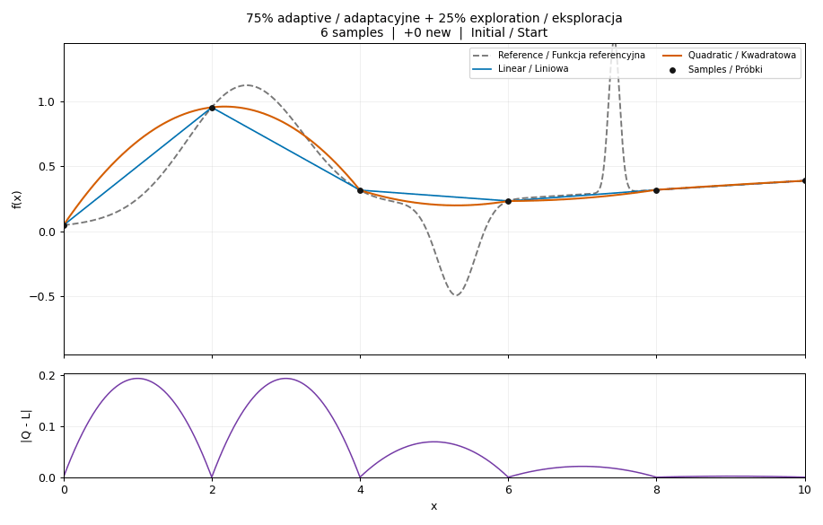

# Adaptive Interpolation Sampling / Adaptacyjne próbkowanie interpolacyjne

[Repository / Repozytorium](https://github.com/rkotynski/adaptive_interpolation) · [English](#english) · [Polski](#polski) · [Citation / Cytowanie](#citation--cytowanie) · [License / Licencja](#license--licencja)

**Author / Autor:** **Rafał Kotyński**, University of Warsaw / Uniwersytet Warszawski  
**Code written by / Kod napisany przez:** **ChatGPT (OpenAI)** under the author's guidance / zgodnie z wytycznymi autora  
**License / Licencja:** [MIT](LICENSE)  
**Sampling strategy / Strategia próbkowania:** 75% interpolation-guided adaptation and 25% longest-interval exploration. / 75% adaptacji na podstawie interpolacji oraz 25% eksploracji najdłuższego przedziału.



*The animation shows a broad maximum (characteristic width 1.10), a narrower minimum (0.36), and a very narrow maximum (0.105). The widths refer to Gaussian scale parameters, not FWHM.*  
*Animacja przedstawia szerokie maksimum (parametr szerokości 1,10), węższe minimum (0,36) i bardzo wąskie maksimum (0,105). Podane wartości są parametrami skali Gaussa, a nie FWHM.*

---

## English

### Motivation and scientific provenance

Computationally expensive models, such as rigorous coupled-wave analysis (RCWA), often produce parameter-dependent responses that are smooth over most of the domain but contain narrow optical resonances. Uniform sampling can allocate too many expensive evaluations to smooth regions or miss sharp features. This repository demonstrates adaptive acquisition of a one-dimensional real-valued response, using a disagreement between two interpolating functions to select new samples.

**The concept of adaptive data-point selection with linear and quadratic interpolation was proposed and employed for expensive RCWA calculations in** Janaszek *et al.* (2024), in particular **Figure 12 and its discussion**. Please **cite that paper if the software is useful**. The present code is an independent, openly distributed research/teaching implementation; it is not a claimed bit-for-bit reproduction of the numerical procedures or results of the paper. See [Citation](#citation--cytowanie).

### How the algorithm works

1. Supply a scalar function `f(x,a)`, bounds, and optional previously computed `x0,y0` samples. Existing values are reused **without evaluating the expensive function again**. Otherwise, initialize using the interval endpoints and a point near the midpoint.
2. Build two interpolation models from the existing nodes. Choose among `linear`, `quadratic`, `pchip`, and `spline`. The default configuration uses to **`linear` versus `pchip`**. The multiscale example explicitly uses **`linear` versus `quadratic`**.
3. For each adjacent interval, compare the interpolants on `n_tests` interior points (default **20**). An optional global grid mode tests uniformly spaced points across the entire domain, including an interval midpoint for every interval. No expensive function calls are needed for these comparisons.
4. Draw a fresh random value **once per new sample**. With probability `exploration_fraction = 0.25`, select the **exact midpoint of the longest eligible interval**, regardless of its interpolation discrepancy. With the remaining probability `0.75`, use the adaptive selection rule: the maximum interpolation disagreement while it exceeds `abs_tol + rel_tol * (max(y)-min(y))`. When the disagreement meets tolerance but some intervals exceed `max_step`, the adaptive branch bisects the longest such interval. The alternative `step` priority is still available.
5. In the adaptive discrepancy branch, choose the position of maximum detected disagreement, or optionally the **vertex of the local parabola**. Near machine-zero discrepancy, choose the midpoint. Random displacement (`jitter`, default **0.04**) affects only this discrepancy branch. **Exploration and maximum-step fallback always use exact midpoints**, without jitter or vertex selection.
6. Store the expensive model value and repeat until the tolerance and maximum-step requirements hold, or the new-evaluation/total-point budget or numerical precision limit is reached.

To disable random exploration, set `exploration_fraction=0` (Python) or `udzial_eksploracji=0` (MATLAB). To force bisection only, set the fraction to 1. The algorithm stops when the interpolation tolerance **and** maximum-step criterion hold, even if a completely unseen narrow feature remains.

The local piecewise quadratic interpolation uses the three-node stencil `max(0,min(i-1,n-3))` for zero-based interval `i`. This matters: choosing the nearest neighbor on either side () produces a different interpolant and therefore different sampling decisions.

**Important:** Two interpolants may agree while both are incorrect. Their difference is a *heuristic discrepancy indicator, not a certified interpolation error*. A feature entirely missed by initial samples cannot be guaranteed to be detected. The demonstration starts from **six uniformly spaced points only**, with **no initial samples added around the narrow resonance**. With the supplied seed and sample budget, exploration finds the peak. This is an empirical result for this example, **not a finite-budget guarantee**. Positive exploration probability eventually refines all intervals in the absence of premature stopping, but narrow structures can still be missed at a finite budget.

### Multiscale demonstration

Both examples use

```text
f(x) = 0.04 + 0.035*x
     + 1.00*exp(-((x-2.45)/1.10)^2)
     - 0.72*exp(-((x-5.30)/0.36)^2)
     + 1.18*exp(-((x-7.43)/0.105)^2)
```

on `[0,10]`, with initial sample locations

```text
[0, 2, 4, 6, 8, 10]
```

The example uses `max_new=90`, `exploration_fraction=0.25` and `seed=2026`. The random ratio is statistical and the observed percentage may deviate from 25%; the two languages use different RNGs. The reference curve in the Python GIF is for **demonstration and verification only**. A real expensive solver would not be evaluated on this dense plotting grid. In contrast, interpolating curves and discrepancy indicators reuse only already computed function values. The green open circle highlights the newest sample. The bottom plot displays `|quadratic - linear|`.

### Python installation, demo, and tests

Python 3.9 or newer is recommended. NumPy and SciPy are needed for the core; Matplotlib and Pillow for GIF export, and pytest for tests.

```bash
git clone https://github.com/rkotynski/adaptive_interpolation.git
cd adaptive_interpolation
python -m pip install -e '.[demo,test]'
python -m pytest -q
python examples/demo_python.py
```

Outputs are `assets/adaptive_sampling.gif` and `assets/final_state.png`. The GIF is **included in the repository**, so it is visible on GitHub immediately without running the example. CI tests are configured in `.github/workflows/python-tests.yml`.

### Python API and examples

```python
import numpy as np
from adaptive_sampling import sample_adaptive, interpolate_samples

# EN: Replace with a slow solver. PL: Zastąp kosztownym modelem.
def model(x, parameters):
    return np.cos(x) + parameters['strength']*np.exp(-((x-3)/.3)**2)

result = sample_adaptive(
    model, 0.0, 6.0, {'strength': 0.7},
    max_new=60, max_points=100,
    abs_tol=1e-4, rel_tol=1e-3, max_step=.2,
    method1='linear', method2='quadratic',
    grid_mode='local', n_tests=20,
    priority='disagreement', point_choice='difference',
    jitter=0, exploration_fraction=0.25, seed=2026,
)
print(result.info['reason'], result.info['new_evaluations'])
x_dense = np.linspace(0, 6, 600)
y_interpolated = interpolate_samples(result.x, result.y, x_dense, 'quadratic')

# Resume / Wznowienie: never reevaluate the old samples.
continued = sample_adaptive(model, 0.0, 6.0, {'strength': 0.7},
                      x0=result.x, y0=result.y, max_new=30,
                      max_points=150, max_step=.1)
```

The function returns `SamplingResult(x, y, info, history)`. Sample locations are sorted; `info` describes the stop reason, number of new expensive evaluations, initial count, final discrepancy, spacings, and selection history. `history` contains `(x, y, new_x)` snapshots. `point_choice='vertex'` chooses an internal quadratic extremum when available. The Python options are documented below alongside their MATLAB counterparts.

| Python parameter | MATLAB option | Meaning |
| --- | --- | --- |
| `x0, y0` | `x0, y0` | Reuse precomputed samples |
| `max_new` | `maks_nowych` | Number of **new** expensive function calls (default 100) |
| `max_points` | `maks_punktow` | Total samples allowed (default 200) |
| `abs_tol` | `tol_bezwzgl` | Absolute discrepancy tolerance (default 1e-3) |
| `rel_tol` | `tol_wzgl` | Fraction of observed output span (default 1e-2) |
| `max_step` | `maks_krok` | Maximum sample separation (default infinity) |
| `method1, method2` | `interpolacja1, interpolacja2` | Interpolants (default linear, pchip) |
| `grid_mode` | `tryb_siatki` | `local`/`global` = `lokalna`/`globalna` |
| `n_tests` | `liczba_testow` | Interior tests **per interval** (default 20) |
| `n_global` | `liczba_testow_globalnych` | Uniform global test points (default 400) |
| `priority` | `priorytet_wyboru` | `disagreement`/`step` = `rozbieznosc`/`krok` |
| `exploration_fraction` | `udzial_eksploracji` | Chance of bisecting the longest eligible interval (default 0.25) |
| `point_choice` | `wybor_punktu` | `difference`/`vertex` = `roznica`/`wierzcholek` |
| `jitter` | `losowosc` | Fractional random displacement, 0–0.25 (default .04) |
| `seed` | `ziarno_losowe` | Optional random seed; generators differ across languages |

Selection histories are available in `result.info['selection_modes']`, along with `exploration_count`, `disagreement_count`, and `step_fallback_count`. Initial endpoint evaluations (when necessary) are not counted as selection decisions. The 75%/25% split is probabilistic, not a forced exact quota.

The MATLAB version additionally exposes `rysuj`, `odswiezaj_co`, `opoznienie`, and `numer_rysunku` for live figures. The Python example handles plots and animation separately. Results need not agree point-by-point across languages when jitter is nonzero because MATLAB and NumPy use different random generators. SciPy and MATLAB/Octave interpolation implementations can also show small numerical differences.

### MATLAB / GNU Octave instructions

Open MATLAB or GNU Octave in the `matlab` directory, then run:

```matlab
addpath('matlab');
test_probkowania
przyklad_probkowania
```

Use `addpath('matlab')` **from the repository root**. If already within `matlab/`, omit it. The example writes `assets/adaptive_sampling_matlab.gif` when the graphics backend supports `getframe`, `frame2im`, `rgb2ind`, and GIF writing. It reconstructs intermediate plots from the final stored sample values, without rerunning the expensive function. The MATLAB GIF is not required to view the pre-generated Python GIF in this README.

A direct call is:

```matlab
f = @(x,a) sin(x) + a*exp(-((x-3)/0.2).^2);
opcje = struct('maks_nowych',60,'maks_punktow',100,...
  'interpolacja1','linear','interpolacja2','quadratic',...
  'priorytet_wyboru','rozbieznosc','udzial_eksploracji',0.25,...
  'ziarno_losowe',2026,'maks_krok',0.2);
[x,y,info] = probkuj_adaptacyjnie(f,0,6,0.8,opcje);
```

### Structure

```text
adaptive_interpolation/
├── README.md                     bilingual project documentation
├── LICENSE                       MIT license
├── CITATION.cff                  suggested scientific citation
├── pyproject.toml                Python package configuration
├── src/adaptive_sampling/
│   ├── __init__.py
│   └── sampling.py                      Python implementation 
├── matlab/
│   ├── probkuj_adaptacyjnie.m     sampling algorithm with bilingual comments
│   ├── interpoluj_probki.m        interpolation with bilingual comments
│   ├── przyklad_probkowania.m    multiscale example + GIF export
│   ├── test_probkowania.m        MATLAB/Octave regression tests
│   └── README.md
├── examples/demo_python.py       multiscale example + rendered animation
├── tests/test_sampling.py              Python regression tests
├── assets/
│   ├── adaptive_sampling.gif
│   └── final_state.png
└── .github/workflows/            Python CI
```

### Limitations and best practices

- **No strict error guarantee:** interpolation disagreement can underestimate the error, including at narrow undetected peaks, oscillations, and discontinuities.
- **Sampling is scalar:** the model accepts a scalar coordinate and returns a finite real scalar. Complex quantities must be mapped to a real objective (e.g. reflectance, absorptance, or magnitude).
- **Performance:** interpolant evaluation is cheap relative to RCWA but can become noticeable with extremely many nodes and densely sampled test grids. The current implementation is single-process and has no automatic caching across sessions beyond explicitly supplied `x0,y0`.
- **Stopping:** if `max_new` or `max_points` is reached, neither the tolerance nor `max_step` is guaranteed to have been met. Check `info['reason']` and the residual metrics.
- **Fair validation:** compare with independent validation points or a reference solution; do not treat the dense reference in the illustrative GIF as an operation that would be affordable in a real RCWA run.
- **Reproducibility:** use `jitter=0` for closer correspondence between MATLAB and Python. Precompute and save expensive sample values for safe continuation.

---

## Polski

### Cel i kontekst naukowy

Kosztowne modele numeryczne, m.in. RCWA (rigorous coupled-wave analysis), często generują funkcje o różnej skali zmian: długie, gładkie fragmenty współistnieją z wąskimi rezonansami. Próbkowanie równomierne może wymagać nadmiernej liczby obliczeń, a mimo to nie wykrywać ostrych ekstremów. Przedstawiony program dobiera nowe punkty adaptacyjnie na podstawie **rozbieżności dwóch interpolantów**.

**Idea takiego adaptacyjnego próbkowania z interpolacją liniową i kwadratową została zaproponowana i wykorzystana do kosztownych obliczeń RCWA w pracy Janaszek i in. (2024), przede wszystkim na rysunku 12 i w jego opisie.** Jeżeli program okaże się użyteczny, **prosimy o cytowanie tej publikacji**. Obecne repozytorium zawiera samodzielną implementację badawczą i dydaktyczną; nie deklarujemy dokładnego odtworzenia każdej technicznej decyzji ani wyników artykułu.

### Zasada działania

1. Funkcja przyjmuje przedział `[xmin,xmax]`, funkcję `f(x,a)` oraz opcjonalne, wcześniej wyznaczone próbki `x0,y0`. Stare wyniki nie są ponownie liczone. W przeciwnym razie program oblicza wartości na końcach przedziału i w jego środku (z opcjonalnym przesunięciem).
2. Tworzy dwie interpolacje z dostępnych: `linear`, `quadratic`, `pchip`, `spline`. Domyślne metody programu to **linear i pchip**. W przykładzie celowo używamy **linear i quadratic**.
3. Porównuje interpolanty w domyślnie **20 punktach wewnątrz każdego przedziału** (`tryb_siatki='lokalna'`). Alternatywnie można zastosować siatkę globalną (`'globalna'`), uzupełnioną środkami przedziałów. Samo porównanie nie wymaga wywołań kosztownej funkcji.
4. **Dla każdego nowego punktu** losuje niezależnie tryb: z prawdopodobieństwem **25%** (`udzial_eksploracji=0.25`) wybiera **dokładny środek najdłuższego dopuszczalnego przedziału**, nawet jeśli interpolanty są tam zgodne. Z prawdopodobieństwem **75%** wybiera strategię adaptacyjną, czyli największą rozbieżność interpolantów. Jeśli rozbieżności mieszczą się w tolerancji, ale nie jest spełnione `maks_krok`, gałąź adaptacyjna zagęszcza najdłuższy przedział przekraczający limit.
5. Tylko przy adaptacji do rozbieżności można wybrać wierzchołek lokalnej paraboli (`wybor_punktu='wierzcholek'`) i wprowadzić losowe przesunięcie (`losowosc`). **Eksploracja zawsze wybiera środek**, bez przesunięcia.
6. Wywołuje kosztowną funkcję tylko dla nowego punktu. Zatrzymuje się po spełnieniu warunków albo po osiągnięciu limitu próbek, nowych wywołań lub dokładności numerycznej.

**Istotny szczegół:** interpolacja kwadratowa używa kolejnych trzech węzłów, zwykle z węzłem poprzedzającym wybrany przedział. Wybór węzłów ma wpływ na interpolant i decyzje o próbkowaniu.

**Ograniczenie metody:** mała różnica interpolantów nie gwarantuje małego błędu względem prawdziwej funkcji. Program może przeoczyć rezonans węższy od odstępów między próbkami, dlatego warto stosować strategię mieszaną (eksploracja/adaptacja), odpowiedni `maks_krok` oraz niezależną walidację. Przy nieograniczonej liczbie iteracji eksploracja pomaga pokryć cały przedział, jednak nie gwarantuje wykrycia piku w skończonym budżecie.

### Przykład z ekstremami o różnych szerokościach

Na przedziale `[0,10]` przyjęto szerokie maksimum Gaussa o parametrze szerokości **1,10**, minimum o szerokości **0,36** oraz bardzo wąski pik o szerokości **0,105**. Najszersze i najwęższe ekstremum różnią się więc skalą ponad **10 razy**. Wszystkie parametry funkcji i współrzędne **6 równomiernych próbek początkowych** znajdują się w przykładach (`examples/demo_python.py` oraz `matlab/przyklad_probkowania.m`).

Na animacji szara linia przerywana to wartość dokładna funkcji **wyłącznie do wizualizacji**. Niebieska linia przedstawia interpolację liniową, pomarańczowa — kwadratową, czarne punkty — rzeczywiste próbki, zielone kółko — nowo dodany punkt. Dolny panel prezentuje różnicę interpolantów. Początkowe próbki są równomierne: **[0, 2, 4, 6, 8, 10]**. Żadnego punktu nie dodano specjalnie w pobliżu wąskiego maksimum. Dzięki eksploracji w tym uruchomieniu maksimum zostało wykryte, ale nie jest to matematyczna gwarancja dla dowolnej funkcji i skończonej liczby próbek. Przyjęto `maks_nowych=90`, `udzial_eksploracji=0.25` i `ziarno_losowe=2026`.

### Instalacja i uruchomienie Pythona

```bash
git clone https://github.com/rkotynski/adaptive_interpolation.git
cd adaptive_interpolation
python -m pip install -e '.[demo,test]'
python -m pytest -q
python examples/demo_python.py
```

Instalacja wymaga **NumPy** i **SciPy**; generowanie GIF wykorzystuje **Matplotlib** i **Pillow**, a testy — **pytest**. Animacja `assets/adaptive_sampling.gif` jest już dołączona do repozytorium i wyświetlana w README. Nie trzeba jej generować ponownie, aby obejrzeć działanie programu.

Główną funkcją jest `sample_adaptive(func, xmin, xmax, a, ...)`. Zwraca obiekt `SamplingResult` o polach `x`, `y`, `info`, `history`. Metody `interpolate_samples` i `interval_disagreement` służą odpowiednio do obliczania interpolacji i diagnostyki. W tabeli w części angielskiej opisano wszystkie odpowiedniki parametrów wersji MATLAB oraz Python.

### MATLAB / GNU Octave

Uruchom z katalogu głównego repozytorium:

```matlab
addpath('matlab');
test_probkowania
przyklad_probkowania
```

Przykład wykorzystuje funkcję `probkuj_adaptacyjnie(f,xmin,xmax,a,opcje)` z  i funkcję `interpoluj_probki`. Próbuje zapisać GIF do `assets/adaptive_sampling_matlab.gif`, o ile używany system graficzny obsługuje `getframe`, `frame2im`, `rgb2ind` oraz zapis GIF. Animacja jest odtwarzana ze zgromadzonych próbek, bez dodatkowego obliczania funkcji. Wersja MATLAB/Octave wymaga sprawdzenia w docelowym środowisku.

### Praktyczne ograniczenia

- Różnica interpolacji **nie jest ścisłym oszacowaniem błędu**. Używaj niezależnych próbek walidacyjnych oraz wiedzy o modelu fizycznym.
- Funkcja celu przyjmuje skalarne `x`, a zwraca skończoną, rzeczywistą wartość. Dla odpowiedzi zespolonej należy wybrać interesującą wielkość rzeczywistą, np. reflektancję lub absorpcję.
- Osiągnięcie limitu `maks_nowych` lub `maks_punktow` może nastąpić zanim program uzyska tolerancję lub wymagany `maks_krok`. Odczytaj `info`.
- Model nie jest automatycznie zapisywany do pamięci podręcznej między uruchomieniami. Można jednak wznowić obliczenia, przekazując istniejące `x0,y0`, co eliminuje ich ponowne wyznaczanie.
- Wprowadzenie losowego przesunięcia powoduje, że ciągi punktów Pythona i MATLAB-a nie muszą być identyczne. Dla łatwiejszego porównania ustaw `losowosc=0` / `jitter=0`.

---

## Citation / Cytowanie

**Please cite this scientific article if the code is useful. / Prosimy o cytowanie artykułu, jeśli kod okaże się przydatny.** The adaptive sampling and interpolation approach was proposed and used for computationally expensive RCWA calculations, with a discussion in **Figure 12**. / Adaptacyjne próbkowanie i interpolację zaproponowano i wykorzystano do kosztownych obliczeń RCWA, opisując metodę przy **rysunku 12**.

Janaszek A., Wróbel P., Dems M., Ceylan O., Gurbuz Y., Kubiszyn Ł., Piotrowski J., Kotyński R. (2024), **Rigorous optical modelling of long-wavelength infrared photodetector with 2D subwavelength hole array in gold film**, *Opto-Electronics Review*, **32**, e148831. [DOI: 10.24425/opelre.2024.148831](https://doi.org/10.24425/opelre.2024.148831). [Publication page](https://www.igf.fuw.edu.pl/pl/publications/1177/).

```bibtex
@article{Janaszek2024,
  author  = {Janaszek, A. and Wróbel, P. and Dems, M. and Ceylan, O. and
             Gurbuz, Y. and Kubiszyn, Ł. and Piotrowski, J. and Kotyński, R.},
  title   = {Rigorous optical modelling of long-wavelength infrared photodetector
             with 2D subwavelength hole array in gold film},
  journal = {Opto-Electronics Review},
  volume  = {32},
  pages   = {e148831},
  year    = {2024},
  doi     = {10.24425/opelre.2024.148831}
}
```

The `CITATION.cff` file provides citation metadata for GitHub. / Plik `CITATION.cff` zawiera informacje bibliograficzne rozpoznawane przez GitHub.

## License / Licencja

The code is released under the **MIT License**, see [LICENSE](LICENSE). / Kod jest udostępniany na warunkach **licencji MIT**, zob. [LICENSE](LICENSE).

## Disclaimer / Zastrzeżenia

**EN:** This project is provided **"as is"**, without warranty of correctness, fitness for a particular purpose, numerical stability, completeness, or suitability for engineering or scientific decisions. The authors and contributors accept no responsibility for losses or damages arising from its use. Verify results independently, especially before publication, design, or deployment. The code was generated by ChatGPT (OpenAI) under Rafał Kotyński's direction and may contain mistakes. Neither OpenAI nor the University of Warsaw is presented as endorsing or certifying the software. The attached GIF is an illustrative numerical example, not experimental validation.

**PL:** Projekt jest udostępniany **„w stanie, w jakim jest”**, bez gwarancji poprawności, przydatności do określonego celu, stabilności numerycznej, kompletności czy możliwości stosowania do decyzji naukowych i inżynierskich. Autor i współtwórcy nie ponoszą odpowiedzialności za straty lub szkody wynikające z jego użycia w zakresie przewidzianym prawem. Wyniki należy samodzielnie weryfikować, szczególnie przed publikacją, projektowaniem lub wdrożeniem. Kod został wygenerowany przez ChatGPT (OpenAI) zgodnie z wytycznymi Rafała Kotyńskiego i może zawierać błędy. Nie oznacza to poparcia ani certyfikowania programu przez OpenAI lub Uniwersytet Warszawski. Animacja GIF przedstawia przykład obliczeniowy, a nie weryfikację eksperymentalną.
